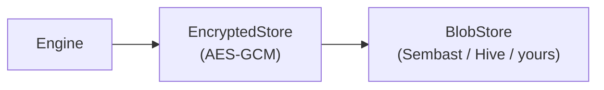

# Storage adapters

Conclave persists encrypted blobs through a small port, `BlobStore`. The engine
never talks to a database directly — it talks to this interface, so you can pick
a backend or write your own.

## The `BlobStore` port

```dart
abstract interface class BlobStore {
  Future<void> open();
  Future<List<int>?> read(String key);
  Future<void> write(String key, List<int> bytes);
  Future<void> delete(String key);
  Future<List<String>> keys({String? prefix});
  Future<void> close();
}
```

A `BlobStore` stores opaque byte arrays keyed by string. It never sees plaintext:
Conclave wraps it in an `EncryptedStore` decorator that encrypts on `write` and
decrypts on `read`, so values are AES-256-GCM ciphertext at rest.



## Built-in backends

### Sembast — `conclave_sembast`

The default backend used by `openDefault`. A pure-Dart NoSQL store that works on
all platforms.

```dart
final store = SembastStore(namespace: 'shopping/home');
```

- `namespace` scopes the database file and keys.
- Pass `factory: databaseFactoryMemory` for tests, or a custom `path`.

### Hive — `conclave_hive`

A lightweight, fast key-value backend.

```dart
final store = HiveStore(namespace: 'shopping/home', path: dir.path);
```

The namespace is sanitised into a valid box name (filesystem-safe, lowercase).

## Choosing a backend

| | Sembast | Hive |
| --- | --- | --- |
| Default in `openDefault` | ✅ | — |
| Pure Dart | ✅ | ✅ |
| Stores | base64 strings | `Uint8List` |
| Good when | you want the default, no setup | you already use Hive |

Both pass the same conformance suite, so they behave identically through the
port. Switching is a one-line change to the `store` factory you pass to
`Conclave.open`.

## Writing your own `BlobStore`

Implement the six methods and prove it with the shared conformance suite that
ships in `conclave_core`'s `test_support/`:

```dart
import 'package:test/test.dart';
import '../../conclave_core/test_support/blob_store_conformance.dart';

void main() {
  runBlobStoreConformance(() => MyStore(namespace: 'conformance'));
}
```

The suite covers read-missing, write/read round-trip, overwrite, delete (and
delete no-op), key listing with and without a prefix, and empty payloads. If your
store passes it, it works with Conclave.

Then pass it to `Conclave.open`:

```dart
final conclave = await Conclave.open(
  config: ConclaveConfig(appId: 'myapp', salt: 'myapp:v1'),
  store: (dbId) => MyStore(namespace: 'myapp/$dbId'),
  // ...other adapters
);
```
