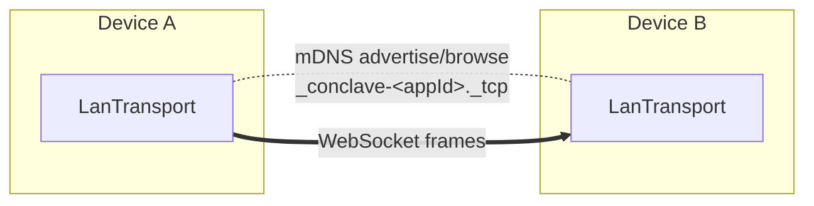

# Transport adapters

Conclave moves encrypted frames between devices through the `Transport` port.
The default is a LAN transport, but the engine depends only on the interface, so
you can supply your own.

## The `Transport` port

```dart
abstract interface class Transport {
  Stream<PeerEvent> get events;            // PeerConnected / PeerLost
  Stream<InboundFrame> get inbound;        // frames arriving from peers
  Future<void> start({required NodeId self, required String appId});
  Future<void> send(PeerId to, Frame frame);
  Future<void> stop();
}
```

- A `Frame` is `(room, bytes)` — an opaque, already-encrypted payload tagged with
  a room.
- `events` reports peers joining and leaving; `inbound` delivers their frames.
- The transport knows nothing about encryption or CRDTs — it just discovers peers
  and ships bytes.

## The LAN transport — `conclave_lan`

The default used by `openDefault`. It combines mDNS service discovery with
WebSocket data connections, all in pure Dart.

```dart
final transport = LanTransport();
```

### How it works



1. **Advertise.** On `start`, the transport binds a WebSocket server on an
   ephemeral port and advertises an mDNS service `_conclave-<appId>._tcp` whose
   TXT record carries this device's node id and port.
2. **Discover.** It browses the same service type periodically and learns peers'
   node ids and addresses.
3. **Connect once.** To avoid a duplicate connection per pair, only the device
   with the lexicographically smaller node id dials; the other accepts. After a
   one-line node-id handshake, the connection is live.
4. **Exchange frames.** `send` writes a length-prefixed, encrypted frame; inbound
   binary messages are decoded and surfaced on `inbound`.
5. **Stay healthy.** WebSocket ping/pong detects dead links; the dialing side
   reconnects with exponential backoff.

### Testing note

The LAN transport is the only socket-bound code in Conclave. Its loopback
integration test is tagged `integration` and excluded from the default unit run;
run it explicitly:

```sh
dart test --run-skipped -t integration packages/conclave_lan
```

The `FrameCodec` itself has fast, socket-free unit tests that always run.

## Writing your own `Transport`

Implement the five members and emit `PeerConnected`/`PeerLost` on `events` and
`InboundFrame`s on `inbound`. Anything that can discover peers and ship bytes
works — Bluetooth, a relay server, WebRTC, a test bus. The in-memory transport in
`conclave_core` (`InMemoryTransport` over an `InMemoryBus`) is a minimal
reference implementation used by the engine tests.

Then pass it to `Conclave.open`:

```dart
final conclave = await Conclave.open(
  config: ConclaveConfig(appId: 'myapp', salt: 'myapp:v1'),
  transport: MyTransport(),
  // ...other adapters
);
```
