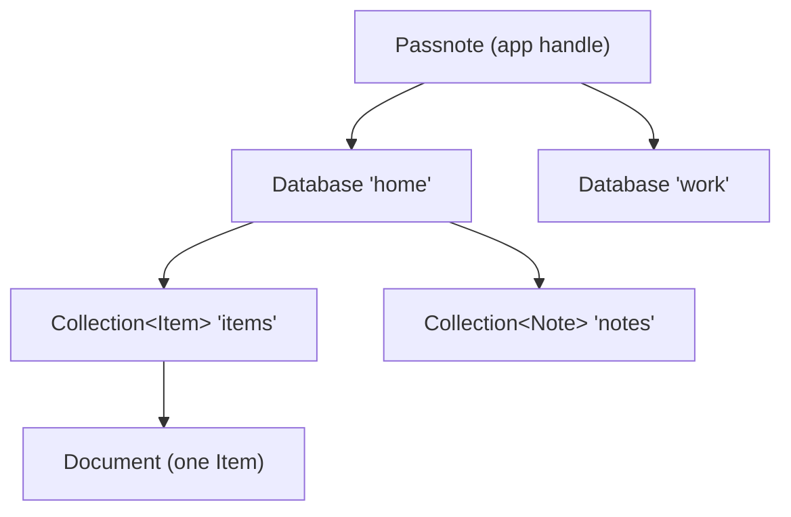

# Data model

!!! abstract "In plain terms"
    Your app works with typed documents in named collections, inside an
    encrypted database. You choose, per collection and per field, what should
    happen when two devices edit the same thing at the same time: last write
    wins, both edits combine into a set, or numbers add up.

## How it works

### Four levels



- A `Passnote` is the app-level handle: one per app, created with the
  [builder](../reference/builder.md). It owns the transport and any number of
  databases.
- A `Database` is one shared, encrypted dataset with its own keys, its own
  device group, and its own discovery [room tag](glossary.md#room-tag).
  Databases are fully isolated from one another.
- A `Collection<T>` is a typed set of documents. Creating it needs a name, a
  codec, and (optionally) a merge strategy:

  ```dart
  final items = db.collection<Item>('items', Item.codec, merge: Item.merge);
  ```

  A collection created without `merge:` uses `ObjectMergeStrategy`, whatever
  the model declares.

- A document is one value of your model type, identified by a stable string
  id. Ids must not contain the ASCII unit separator (`\x1F`).

### Codecs

A `Codec<T>` converts between your type and the stored map, and extracts the
document id. Generate it from annotations (the recommended path):

```dart
part 'task.g.dart';

@Document()
class Task {
  const Task({required this.id, required this.title, this.qty = 0});

  @DocumentId()
  final String id;

  final String title;

  @Crdt(PnCounter())
  final num qty;

  static final Codec<Task> codec = _$TaskCodec;
  static const MergeStrategy merge = _$TaskMergeStrategy;
}
```

`dart run build_runner build` produces the codec, the id extractor, and the
per-field CRDT schema in one pass, so they can never drift apart. For shapes
the generator does not cover, write a `JsonCodec` by hand:

```dart
final taskCodec = JsonCodec<Task>(
  toMap: (t) => t.toJson(),
  fromMap: Task.fromJson,
  idOf: (t) => t.id,
);
```

### Merge strategies

A `MergeStrategy` decides how a document splits into independently clocked
records, which decides how concurrent edits to one document merge:

| Strategy | Granularity | Two devices edit one document |
| --- | --- | --- |
| `ObjectMergeStrategy` (default) | Whole document | Latest write wins; the other edit is discarded. |
| `ShallowMergeStrategy` | Each top-level field | Edits to different fields both survive. |
| `DeepMergeStrategy` | Every nested leaf | Edits to different leaves both survive; lists stay atomic. Field names must not contain the path separator (default `.`); an offending document is rejected at `put`. Dotted keys (i18n keys, config paths, hostnames) belong on `ShallowMergeStrategy`. |
| `SchemaMergeStrategy` | Per field, with [CRDT](glossary.md#crdt) types | As shallow, plus counters and sets per the schema. |

The strategy is fixed when a collection is first created; all devices sharing
a collection must agree on it.

### Per-field CRDT types

With `SchemaMergeStrategy` (or `@Crdt(...)` annotations), individual fields
merge by richer rules than last write wins:

| Type | Field holds | Concurrent edits |
| --- | --- | --- |
| `LwwRegister` (default) | Any value | Latest write wins. |
| `PnCounter` | A number | Increments from every device all count; the value is their sum. |
| `OrSet` | A list | Adds and removes from every device all apply; an add beats a remove that never saw it. |

A counter changes only through `increment`:

```dart
await items.increment('i1', 'qty', by: 3);
```

A `put` that would set a counter field to a different number throws, because
overwriting a sum from one device's view would silently discard the others'
contributions. A set field is edited by putting the desired list; the engine
turns the difference into adds and removes.

## Edge cases and guarantees

- **Deletion is atomic per document.** Existence lives in one record (the
  [existence register](glossary.md#existence-register)), so a delete and a
  concurrent field edit settle on that single record. A document either
  survives whole or is gone whole.
- **Deletes are kept as [tombstones](glossary.md#tombstone)** so they sync,
  and are physically removed by `compact` after a horizon you choose. A device
  offline longer than the horizon can resurrect a deleted document; pick the
  horizon accordingly.
- **`__t` is reserved.** Map values whose `__t` key holds `or_set` or
  `pn_counter` are how typed fields are stored; do not use `__t` as a field
  name in your documents.
- **Re-requesting a collection** by name returns the same instance; a
  different `merge:` argument on a later call is ignored.
