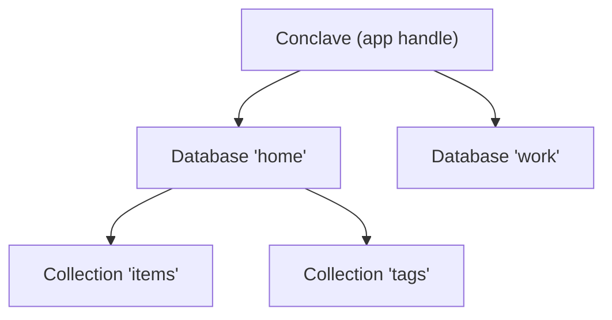
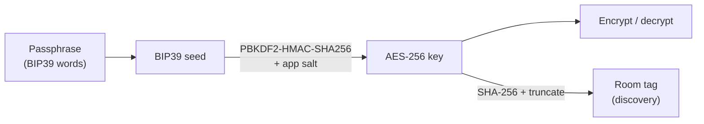

# Databases & keys

Conclave is organised into three nested concepts:



- A **`Conclave`** is the app-level handle. There is one per app, created via
  `openDefault` (or `Conclave.open` for custom wiring). It owns exactly one
  transport and any number of databases.
- A **`Database`** is one shared, encrypted dataset, identified by a local id and
  unlocked by a passphrase.
- A **`Collection<T>`** is a typed, queryable set of documents inside a database.

## Passphrases, keys, and rooms

Each database is unlocked by a **passphrase** — a BIP39 mnemonic. From the
passphrase Conclave derives two things:

1. **An AES-256 encryption key**, via BIP39 seed → PBKDF2-HMAC-SHA256. This key
   encrypts everything at rest and on the wire. It never leaves the device.
2. **A room tag**, a short opaque identifier derived from the key. Devices that
   derive the same key advertise and join the same "room" over mDNS. The room
   tag reveals nothing about the key or the data.



The same passphrase always derives the same key for a given `appId`/`salt`, so
entering it on a second device reconstructs the identical key and joins the same
room — that is the entire pairing mechanism.

## Generating and sharing a passphrase

Generate a passphrase on one device and have the user enter it on the others:

```dart
final words = conclave.generatePassphrase().join(' ');
// Show `words` to the user. On the other device:
final db = await conclave.openDatabase('home', passphrase: words);
```

The word count is configurable through `PassphrasePolicy` (12/15/18/21/24 words,
mapping to 128–256 bits of entropy; 24 is the default):

```dart
final conclave = await openDefault(
  appId: 'shopping',
  salt: 'shopping:v1',
  passphrase: const PassphrasePolicy(words: 12),
);
```

## Multiple databases

A single `Conclave` can hold several databases, each with its own passphrase and
therefore its own key and room. Databases are fully isolated: even when two
databases sync over the same peer connection, a peer that lacks a database's key
cannot read — or detect — its traffic.

```dart
final home = await conclave.openDatabase('home', passphrase: homeWords);
final work = await conclave.openDatabase('work', passphrase: workWords);
```

## The `appId` and `salt`

- **`appId`** namespaces discovery and storage. Only apps sharing an `appId`
  discover one another; storage keys are prefixed with it.
- **`salt`** is a stable, app-specific string folded into key derivation. The
  same passphrase with a different salt produces a different key, so the salt
  pins your keys to your app. Use something like `"myapp:v1"` and keep it
  constant — changing it invalidates every previously derived key.

## Closing

`conclave.close()` closes all open databases and stops the transport. An
individual database can be removed with `db.leave()`, which stops syncing it and
drops its local encryption key.

## Rotating the passphrase

To change a database's passphrase (e.g. after a compromise or as routine key
hygiene) call `rotatePassphrase`:

```dart
await conclave.rotatePassphrase(
  'home',
  oldPassphrase: oldWords,
  newPassphrase: newWords,
);
```

This re-encrypts every blob in the local store with the new key, then updates
the `KeyStore`. If the database is currently open it is closed first — call
`openDatabase` with the new passphrase, or `reopenDatabase`, to resume.

### Peer isolation

Changing the passphrase changes the room tag (it is derived from the key, not
from a stable identifier). After rotation the calling node broadcasts and listens
in a different room, so it can no longer communicate with peers still on the
old key. Those peers continue syncing among themselves unaffected.

To re-establish sync all devices must be rotated to the same new passphrase. The
order does not matter — each device rotates independently, and after they all
reopen in the new room the normal CRDT sync converges any changes made in the
meantime.

### Crash safety

If the process is interrupted (process kill, power loss) the caller has three
recovery paths:

**`openDatabase` with the old passphrase** — the partial rotation is reversed;
every blob is re-encrypted back to the old key and the old key stays primary.

**`openDatabase` with the new passphrase** — the rotation is completed;
remaining old-key blobs are re-encrypted with the new key and the new key is
promoted.

**`reopenDatabase` without a passphrase** — the rotation is always **completed
forward**. This is critical for security: a crash during rotation must not
silently revert on app restart, otherwise a compromised peer would never be
isolated.

All three paths are idempotent and safe to retry. Use `hasPendingRotation` to detect a prior crash before opening.

The crash-safety mechanism works because:
1. Both keys are stored in the `KeyStore` (`rotate_backup` + `rotate_new`)
   before re-encryption starts.
2. The re-encryption loop handles partial progress — a blob already encrypted
   with the target key is decrypted with that same key and re-encrypted (a
   no-op).
3. Only after every blob is confirmed re-encrypted is the appropriate key
   promoted to primary, then the backup entries removed.
