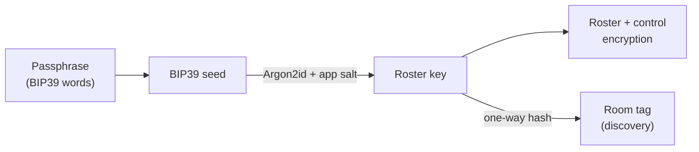

# Identity and keys

!!! abstract "In plain terms"
    Every device has its own keypair that never leaves it. The data itself is
    encrypted with one shared group key, which is sealed individually to each
    device. New devices join with a short one-time code; a lost device is
    revoked by rotating the group key, after which it can read nothing new.

## How it works

### What the passphrase does

Opening a database takes a passphrase (a BIP39 word list by default). Two
things derive from it, per app `salt`:

1. **The roster key**, via BIP39 seed then Argon2id. It encrypts the device
   [roster](glossary.md#roster) and control traffic, and everything else in
   the single-key mode below.
2. **The [room tag](glossary.md#room-tag)**, the public discovery identifier.
   It is a one-way hash: seeing it reveals nothing and grants nothing.



The passphrase is not the data key. User data is encrypted with the group key
below, so knowing the passphrase alone is not enough to read a group's data:
a device must also be admitted to the roster.

Because it carries so little, the passphrase is cheap to change: rotating it
re-encrypts the roster and moves the room tag, and leaves the group key, the
data and every membership alone. See
[Rotate the passphrase](../guides/rotate-the-passphrase.md) — including why
each device has to be rotated or paired again.

### Device keypairs and the group key

Each installation generates an identity: an X25519 key-exchange keypair and an
Ed25519 signing keypair, stored in the OS keychain. The private halves never
leave the device.

The first device to open a database *founds* its group: it generates a random
**[group key](glossary.md#group-key)** and seals ("wraps") it to its own
public key. The wrap lives in the roster, a reserved synced collection
(`__passnote_devices`) holding one record per device plus each device's
wrapped key at the current [key epoch](glossary.md#key-epoch). User
collections are encrypted with the group key, at rest (SQLCipher) and on the
wire.

Founding happens automatically on `openDatabase` **only when no peer is
connected at that instant** and the roster carries no group key yet. That
condition is a snapshot, not a decision: the same second device founds a
rival group when it opens offline, and lands in `needsPairing` when it opens
with the founder reachable. Treat founding as explicit — call
`db.foundGroup()` on the one device that is meant to be first (a no-op check
guards against double-founding), and bring every other device in with the
[pairing flow](../guides/pair-a-device.md), never by retyping the passphrase.

Every roster row is signed with the writing device's Ed25519 key, and every
device validates rows against a trust chain rooted at the founder: a device
record counts only when a known, non-revoked member signed it, a wrapped key
is unwrapped only when a known, non-revoked member wrote it, and a known
device's public key is pinned and cannot change. Holding the roster key
(which is passphrase-derived and never rotates) therefore lets a device
*read* the roster, but writing rows that anyone acts on requires membership.

### Pairing

A new device joins with a one-time nine-digit code:

```dart
// Sponsor (any device that has the data):
final code = await passnote.startPairing('home');
// Joiner:
final db = await passnote.pairWith('home', PairingCode.parse(input));
```

Under the code runs a [PAKE](glossary.md#pake) (SPAKE2): both sides prove they
hold the same code without revealing it and derive a private channel. The
sponsor then admits the joiner to the roster, seals the group key to the
joiner's public key, and hands over its own roster trust state (the founder,
the member keys, the revocations it has validated), which the joiner adopts
before it syncs anything. A wrong code fails visibly; each peer gets three
tries and the code is withdrawn after twenty in total; an eavesdropper who
misses the code learns nothing.

### Revocation

```dart
await passnote.revokeDevice('home', deviceId);
```

Revoking generates a fresh group key at the next epoch, seals it to every
remaining device, re-encrypts the local store, and marks the device revoked in
the roster. Peers adopt the new key as the roster syncs. The revoked device
keeps whatever it already had (nothing can erase a copy it holds), but every
new write is under a key it will never receive. Revocation is monotone and
sticky: each device pins every revocation it sees, and rows signed by a
revoked device stop counting, so the revoked device cannot rotate the key,
re-admit itself, or smuggle a fresh identity into the roster with the roster
key it still holds. Devices the revoked one had admitted keep their standing,
because the revoking device re-signs their roster records. Revocations are
judged in epoch order with the trust chain recomputed after each, so the
outcome does not depend on the order rows arrive in. The revoked device does
keep the passphrase key: it can still find the group and read the roster
(names, public keys, sealed wraps), though no user data or new key. Rotate
the passphrase afterwards if that matters; see
[Revoke a device](../guides/revoke-a-device.md). Two devices revoking different peers at the same time
converge: the surviving device with the lowest id performs one final rotation
covering both.

### Forward secrecy

Each pair of devices runs a per-connection [ratchet](glossary.md#ratchet).
On connect, each side sends an ephemeral X25519 public key signed with its
roster identity; the session root is derived from the group key and the
agreement of the two ephemeral keys, whose private halves are wiped as soon as
the session exists. Message keys then come from a hash chain, each used once
and wiped. Someone who records traffic today and steals a device next month
holds every long-term key, but not the ephemeral ones, so cannot decrypt the
recording. Only a non-revoked roster member can complete the handshake, and
user data travels only inside such a session. Handshakes are tagged with the
key generation they belong to, so sessions never pair across a rotation.

### Optional recovery phrase

By default there is no back door: lose every device and the data is gone,
which is a legitimate product choice. Apps can opt in
(`.recovery(enabled: true)`) to a 24-word recovery phrase:
`enableRecovery` registers a keypair derived from the phrase as a virtual
roster member with its own wrap, and `recoverFrom(phrase, passphrase:)` on a
fresh install re-derives that keypair, syncs the roster from any reachable
peer, and unwraps the group key. A phrase is withdrawn like any device, with
`revokeDevice`. See the
[recovery guide](../guides/recover-from-a-lost-passphrase.md).

## Edge cases and guarantees

- **No identity configured** (a custom `passnoteLowLevel` without one): the
  roster does not exist and the passphrase-derived key encrypts everything.
  This is the single-key mode; the builder always configures an
  identity.
- **A device with no wrap opens in `DeviceState.needsPairing`.** It can sync
  the roster but cannot open user collections until admitted. This is a state,
  not an error.
- **Roster changes are CRDT rows** and converge like any data, including
  concurrent admissions and revocations.
- **The room tag is public by design.** A network observer learns that some
  Passnote database exists and sees frame sizes and timing, nothing more. See
  [Security](../security.md).
