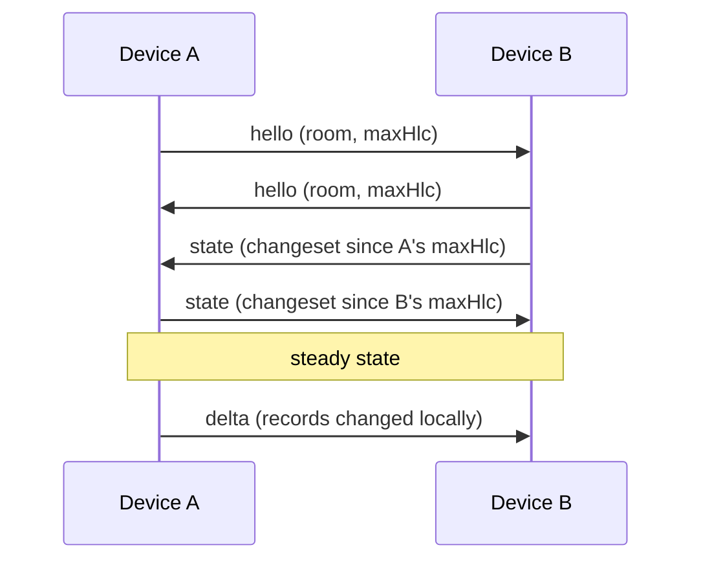

# Sync & CRDTs

Conclave keeps every device's copy of a database identical without a central
server. This page explains how — the CRDT model, Hybrid Logical Clocks, and the
wire protocol.

## Conflict-free replicated data

Each collection is backed by a **CRDT** (Conflict-free Replicated Data Type). A
CRDT is a data structure whose replicas can be updated independently and merged
in any order, always arriving at the same result. Conclave models each
collection as a map from **record key** to value, where every record carries a
timestamp.

- Edits to **different** record keys are independent and both survive a merge.
- Edits to the **same** record key are resolved **last-write-wins**.

A document is split into one or more such records by the collection's
[merge strategy](collections.md#merge-strategies). With the default
`ObjectMergeStrategy` a document is a single record (whole-document LWW); with
`ShallowMergeStrategy` or `DeepMergeStrategy` each field becomes its own record,
so concurrent edits to different fields of one document both survive.

## Hybrid Logical Clocks

"Last write" needs a notion of time that survives clock skew and offline edits.
Conclave uses a **Hybrid Logical Clock (HLC)**: a timestamp combining wall-clock
time with a logical counter and a node id. HLCs are:

- **Monotonic** — they never go backwards on a node, even if the wall clock does.
- **Causally ordered** — if edit A happened-before B, then `hlc(A) < hlc(B)`.
- **Total** — the node id breaks ties, so every device picks the *same* winner
  for concurrent same-key edits.

Each record stores the HLC of its last modification. Merging two records keeps
the one with the higher HLC.

## The wire protocol

When two peers connect, they reconcile state with three message types, all
encrypted end-to-end before they touch the network:

1. **hello** — on connect, each side announces its room and the highest HLC it
   has seen. This lets the peer send only what's missing.
2. **state** — each side replies with a changeset of every record modified after
   the other's reported HLC: a fast catch-up that needs no full transfer.
3. **delta** — thereafter, each local `put`/`delete` broadcasts just the changed
   records to connected peers.

Received changesets are merged into the local CRDT and persisted. Crucially,
merging a remote changeset does **not** re-broadcast it, so deltas don't echo
around the network.

## Offline and reconnect

Because every device holds a full local copy, all reads and writes work offline.
On reconnect the hello/state exchange replays exactly the edits each side missed,
and HLC arbitration guarantees both sides converge to the same state —
regardless of the order in which messages arrive.

## Encryption boundary

The CRDT and protocol operate on plaintext records in memory. Everything below —
both the on-disk blobs and every frame on the wire — is AES-256-GCM encrypted
with the database's key. A peer without the key sees only opaque ciphertext and
an opaque room tag. See [Security](../security.md) for the full threat model.
