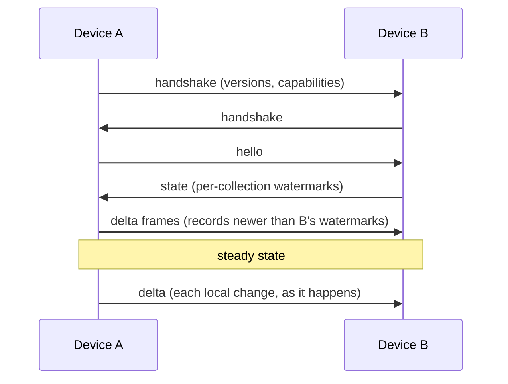

# Sync

!!! abstract "In plain terms"
    Devices find each other, agree on a protocol version, and push changes to
    each other as they happen. A periodic background exchange compares
    fingerprints of what each side holds and repairs any gap, however old. All
    of it travels encrypted; none of it needs a server.

## How it works

### Connecting

When two devices meet on the transport, each sends a handshake: the
[wire versions](glossary.md#wire-version) it speaks, optional capabilities,
and its device public key. Sync starts on the highest version both share. If
there is none (one app is too old), a `PeerIncompatible` event is emitted on
`Passnote.events` and nothing further is exchanged, so the app can tell the
user to update. After a successful handshake the pair establishes its signed,
forward-secret [ratchet](glossary.md#ratchet) session; see
[Identity](identity.md). With device identities in use, user data,
collection names and reconciliation flow only inside that session: before it
exists, two devices exchange the roster and nothing else.

Every received record is also checked against the local clock: one stamped
more than `maxClockDrift` (10 minutes by default) in the future is refused
with the rest of its document, because it would otherwise win every later
merge. Anti-entropy offers it again, so a peer with a skewed clock is delayed,
not lost.

### Push, then catch up

- Every local `put`, `delete`, or `increment` broadcasts just the changed
  records to connected peers, immediately.
- On connect (and on demand), a `hello` asks the peer for its per-collection
  [watermarks](glossary.md#watermark); everything newer flows back as deltas.
- A large [changeset](glossary.md#changeset) streams as bounded frames of at
  most 500 records, split only on document boundaries, so a receiver never
  sees half a document and no single frame grows unbounded.
- Frames to each peer travel through an ordered send window
  (`maxInFlightFrames`, default 16). A slow receiver makes the sender pause at
  the bound instead of buffering without limit.

### Anti-entropy and reconciliation

Push can lose a frame: a flaky link, a device asleep at the wrong moment, the
inbound rate limiter. Every few minutes (`antiEntropyInterval`, default 3
minutes, `Duration.zero` disables) each database runs a repair exchange with
its peers.

With peers that support it, the exchange is
[range reconciliation](glossary.md#range-reconciliation): the devices compare
fingerprints of [HLC](glossary.md#hlc) ranges and recursively split any range
that differs, until the exact differing records are found and shipped. This
finds *any* difference in a few round trips, including a record older than
both watermarks, which a watermark exchange alone could never notice.
Identical devices exchange only fingerprints, a few hundred bytes.

With a peer that lacks the capability, the exchange falls back to the plain
hello/state/delta round.

The same round also runs once per peer as soon as a connection can carry user
data, so a record a device missed while it was away arrives on reconnect even
when it is older than both watermarks. `Database.reconcileNow()` (or
`Passnote.reconcileNow()` for every database) runs one at any time, for
instance after restoring a store from a backup.

### Offline and reconnect

Every device holds a full copy, so reads and writes never wait for the
network. On reconnect, the handshake and catch-up run again and both sides
converge. `Passnote.forceSync()` triggers the full exchange on demand, for a
pull-to-refresh gesture.

## Edge cases and guarantees

- **Convergence does not depend on message order or timing.** Deltas may
  arrive duplicated or interleaved; merging is idempotent and commutative.
- **Received changes are never re-broadcast**, so deltas cannot echo around
  the group.
- **Malformed frames are dropped, never crash.** The binary decoder returns
  null for anything it cannot parse (fuzzed in CI), and a frame that fails
  authentication is discarded.
- **Rate limiting is a guard, not a boundary.** A peer exceeding
  `maxInboundFramesPerSecond` (default 100) has its excess frames dropped;
  anti-entropy repairs whatever that loses.
- **An incompatible peer costs nothing.** After the `PeerIncompatible` event
  its frames are ignored; there is no retry loop.
