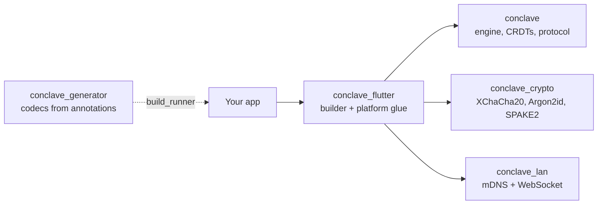

# Conclave

**End-to-end encrypted, server-less, local-first sync for Dart and Flutter.**

Conclave lets a small group of devices share a live, mergeable dataset with no
server and no account. Every device holds a full copy and works offline; new
devices join with a short one-time code; a lost device can be revoked. No
plaintext ever leaves a device.

```dart
final conclave = await conclaveBuilder(
  appId: 'shopping',
  salt: 'shopping:v1',
).open();

final db = await conclave.openDatabase('home', passphrase: words);
final items = db.collection<Item>('items', Item.codec);

await items.put(Item(id: newId(), name: 'Milk'));
items.watch().listen((all) => print('now ${all.length} items'));
```

## Why Conclave

- **End-to-end encrypted.** XChaCha20-Poly1305 on every byte on the wire and
  SQLCipher for the files at rest (verified on open, never assumed), with keys
  that never leave the devices and a forward-secrecy ratchet on every
  connection.
- **Real device membership.** Each device has its own keypair. Joining is a
  nine-digit code over a PAKE; leaving is a revocation that rotates the group
  key away from the lost device. No shared password to rotate by hand.
- **Server-less.** Devices find each other over the local network (or an
  explicit WebSocket address, for browsers) and sync directly. Nothing to
  deploy, nothing to breach centrally.
- **Local-first.** Reads and writes never wait for the network. Concurrent
  edits merge deterministically; counters add up and sets keep everyone's
  changes when you ask for it.
- **Self-healing sync.** Changes push immediately; a periodic fingerprint
  exchange finds and repairs any gap, however old, in a few round trips.
- **Small, swappable parts.** Storage, transport, key store, cipher, identity,
  and PAKE are ports with production adapters; replace any of them without
  touching app code.

## How it fits together



## Packages

| Package | Purpose |
| --- | --- |
| `conclave_flutter` | The entry point for Flutter apps: `conclaveBuilder`, keychain key store, notifiers. Re-exports everything below. |
| `conclave` | The pure-Dart engine: collections, CRDTs, queries, the sync protocol, the SQLite store. |
| `conclave_crypto` | XChaCha20-Poly1305, Argon2id, BIP39, SPAKE2, the device identity. |
| `conclave_lan` | Transports: mDNS LAN discovery (native) and WebSockets (everywhere), plus the reference relay. |
| `conclave_generator` | Generates codecs and CRDT schemas from `@Document()` annotations. |

## Next steps

- [Start here](start-here/index.md): what Conclave is, in one screen.
- [Tutorial](start-here/tutorial.md): empty app to two synced devices.
- [Concepts](concepts/data-model.md): the data model, clocks, sync, identity.
- [Security](security.md): what is protected, and the boundaries.
- [Limits](reference/limits.md): honest numbers on group size and data
  volume.
- [API reference](https://pub.dev/documentation/conclave_flutter/latest/):
  generated dartdoc for every symbol, per package on pub.dev.
