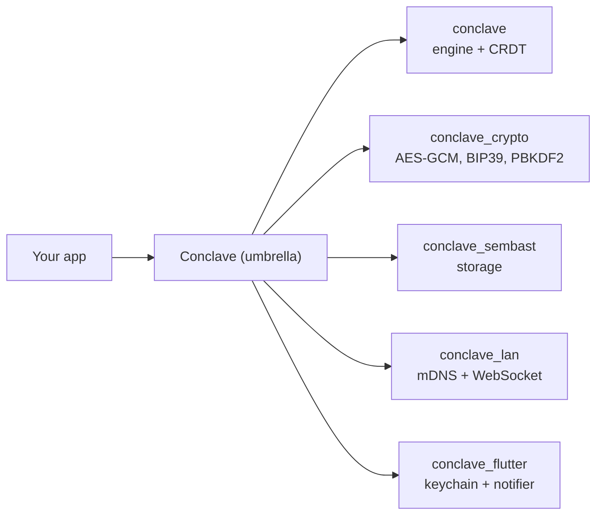

# Conclave

**End-to-end encrypted, server-less, local-first CRDT sync engine for Dart and
Flutter.**

Conclave lets a group of devices share a live, mergeable dataset over the local
network — with no server, no account, and no plaintext ever leaving the device.
Pairing is a passphrase; everything else is automatic.

```dart
import 'package:conclave/conclave.dart';

final conclave = await openDefault(appId: 'shopping', salt: 'shopping:v1');
final list = await conclave.openDatabase('home', passphrase: words);
final items = list.collection<Item>('items', itemCodec);

await items.put(Item(id: newId(), name: 'Milk'));
items.watch().listen((all) => print('now ${all.length} items'));
```

## Why Conclave

- **End-to-end encrypted.** Every byte at rest and on the wire is encrypted with
  AES-256-GCM. The encryption key is derived from a passphrase and never leaves
  the device. Peers that don't hold the key can't read — or even identify — your
  data.
- **Server-less.** Devices discover each other over mDNS and sync directly over
  WebSocket on the LAN. There is nothing to deploy and nothing to pay for.
- **Local-first.** Every device holds a full local copy and works fully offline.
  Edits made while disconnected merge automatically on reconnect.
- **Conflict-free.** State is modelled as CRDTs with Hybrid Logical Clock
  arbitration: concurrent edits to different documents both survive; concurrent
  edits to the same document resolve to the same deterministic winner on every
  device.
- **Ports & adapters.** The engine depends only on small interfaces. Swap
  storage (Sembast, Hive, your own), transport, key store, or cipher without
  touching app code.

## How it fits together



## Packages

| Package                                                   | Purpose                                              |
| --------------------------------------------------------- | ---------------------------------------------------- |
| [`conclave`](https://pub.dev/packages/conclave)           | Umbrella + `openDefault` batteries-included wiring   |
| [`conclave`](https://pub.dev/packages/conclave) | Pure-Dart engine, CRDT collections, ports, protocol  |
| `conclave_crypto`                                         | AES-256-GCM cipher, BIP39 passphrases, PBKDF2        |
| `conclave_sembast`                                        | Sembast-backed `BlobStore`                           |
| `conclave_hive`                                           | Hive-backed `BlobStore`                              |
| `conclave_lan`                                            | LAN transport (mDNS discovery + WebSocket frames)    |
| `conclave_flutter`                                        | Keychain key store + `CollectionNotifier`            |

## Next steps

- [Getting started](start-here/tutorial.md) — install, `openDefault`, first
  collection.
- [Concepts](concepts/data-model.md) — databases, keys, collections, sync.
- [Security](security.md) — the threat model and its limits. **Read this before
  shipping.**
